# Qazan

**Готовь из того, что есть.**

Qazan помогает выбрать блюдо из продуктов, которые уже есть дома, сохранить
понравившиеся рецепты и составить список недостающих ингредиентов.
Учебный Android-проект на Kotlin и Jetpack Compose.

## Первый блок

Реализованы шесть экранов:

- **Главная:** рецепт дня, смена рецепта, категории и переход в холодильник.
- **Холодильник:** ввод и удаление продуктов, быстрые подсказки, защита от дублей.
- **Поиск:** поиск по названию, фильтр категории и подбор по продуктам холодильника.
  Рецепты отсортированы по числу совпадений, затем по названию.
- **Рецепт:** ингредиенты, инструкция, отметки наличия продуктов, избранное
  и добавление недостающего в покупки.
- **Избранное:** сетка сохранённых рецептов и счётчик оставшихся покупок.
- **Покупки:** группировка по рецепту, отметки купленного, прогресс и очистка.

Встроены **10 демонстрационных рецептов**. Интерфейс русский; названия рецептов
и продуктов английские. Вводи, например, `Chicken`, `Rice`, `Tomato`.
Регистр и лишние пробелы не влияют на совпадения; простые формы множественного
числа (`egg` / `eggs`, `tomato` / `tomatoes`) учитываются.

Приложение работает без интернета. В первом блоке нет API, базы данных и настроек
DataStore. Вместо фотографий используются заглушки. Списки хранятся **в памяти
процесса**: переживают переходы между экранами и поворот устройства, но сбрасываются
после завершения процесса приложения. Тема следует системной настройке; цвета
обоев не заменяют фирменную палитру.

## Скриншоты

| Экран | Светлая тема | Тёмная тема |
|---|---|---|
| Главная | 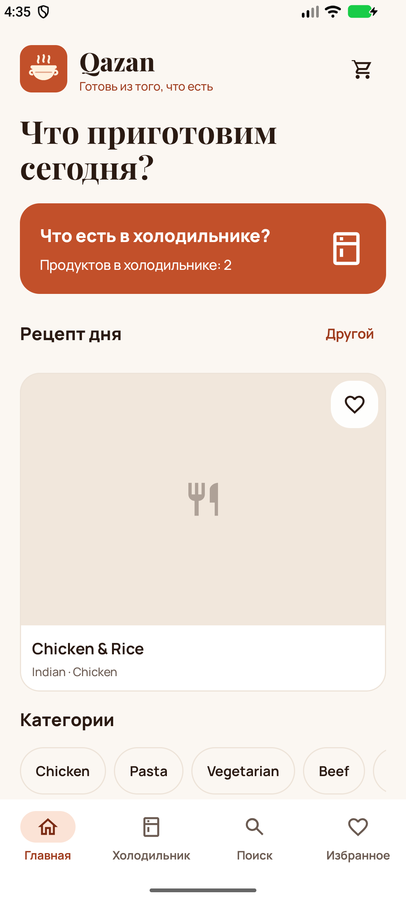 | 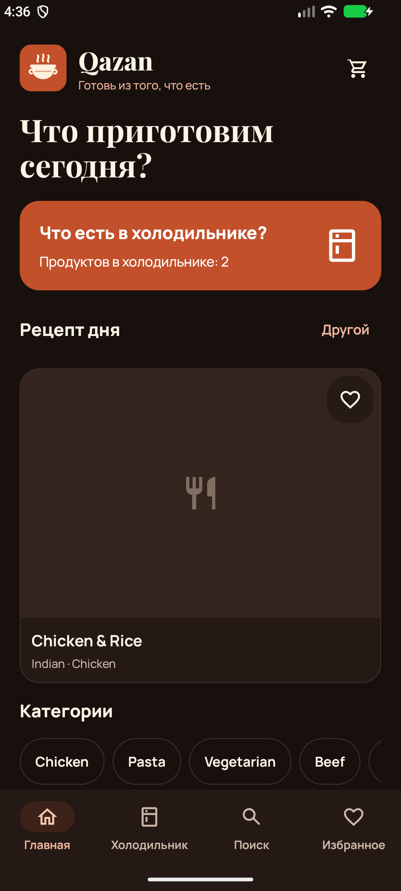 |
| Холодильник | 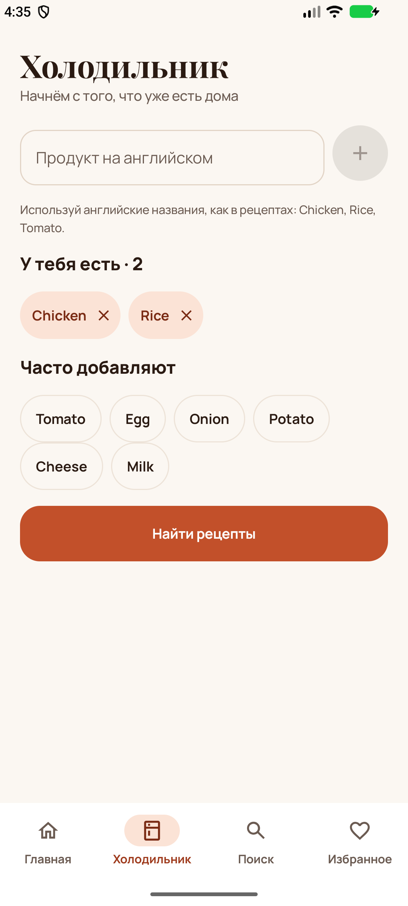 | 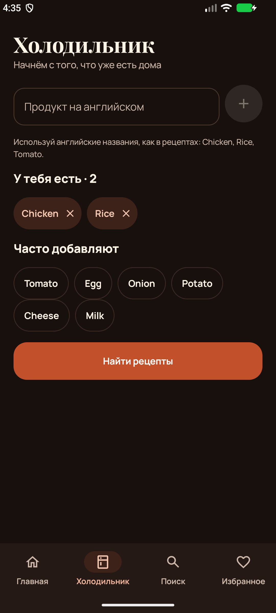 |
| Поиск | 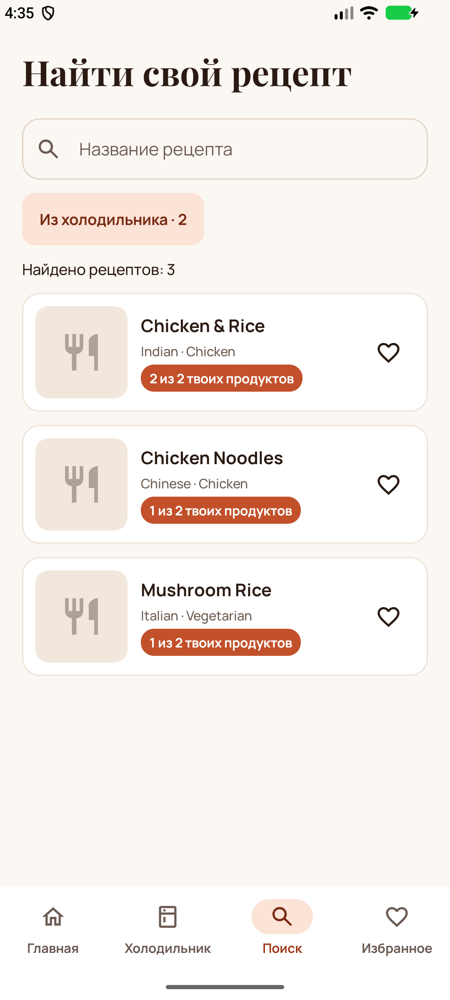 | 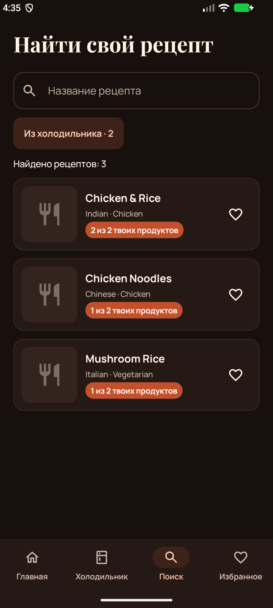 |
| Рецепт | 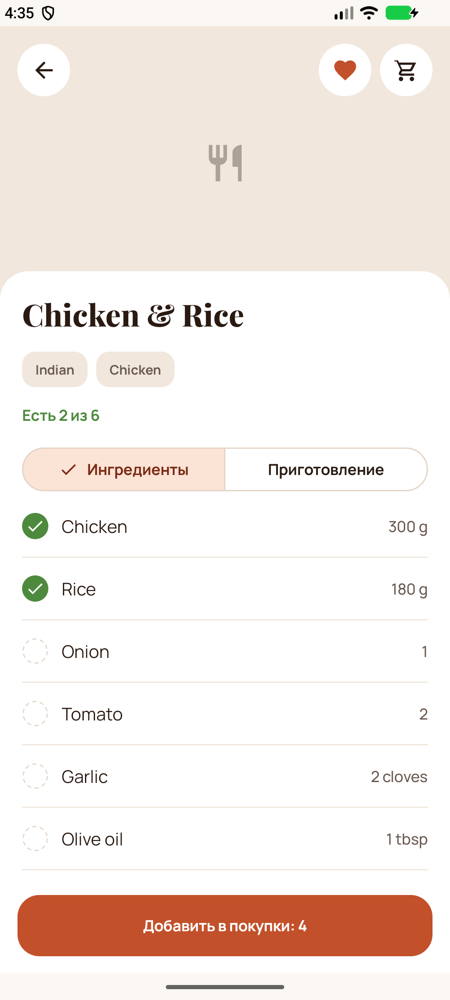 | 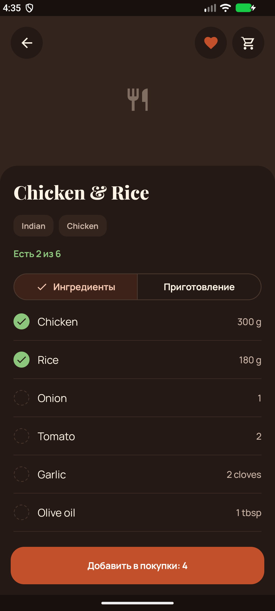 |
| Избранное | 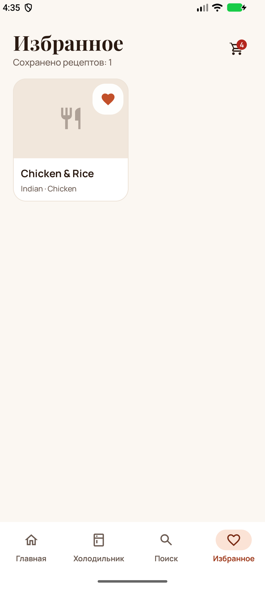 | 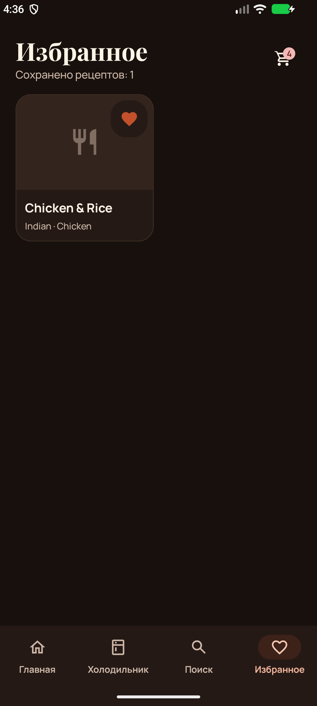 |
| Покупки | 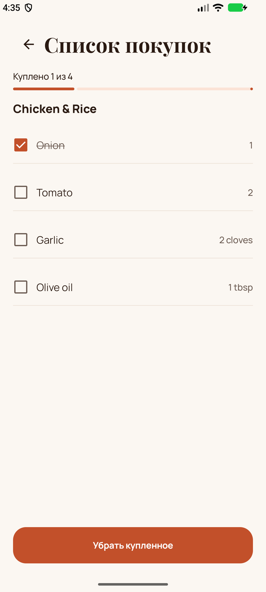 | 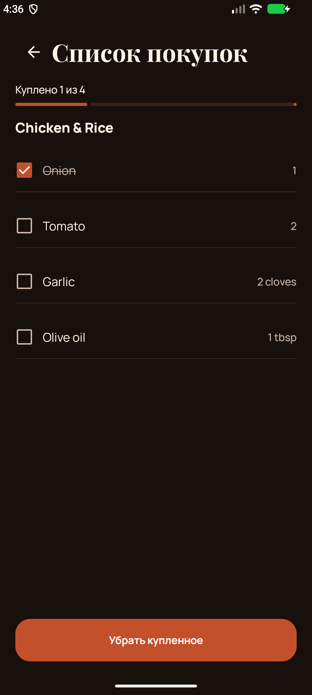 |

## Запуск

1. Открой корень проекта в Android Studio и дождись синхронизации Gradle.
2. Установи Android SDK 37. Gradle использует JDK 25, указанный в
   `gradle/gradle-daemon-jvm.properties`.
3. Выбери эмулятор или устройство с **Android 7.0 (API 24)** или новее.
4. Запусти конфигурацию `app`.

Первая сборка загружает зависимости; самому приложению сеть не нужна.
Путь к локальному Android SDK хранится в `local.properties` и не входит в Git.

Команды в PowerShell:

```powershell
.\gradlew.bat assembleDebug
.\gradlew.bat testDebugUnitTest
.\gradlew.bat lintDebug
```

Готовый APK: `app/build/outputs/apk/debug/app-debug.apk`.

## Архитектура

```text
Screen → событие → ViewModel → Repository
Screen ← UiState / StateFlow ← ViewModel ← Flow
```

- `Route` получает ViewModel из общей фабрики и собирает состояние через
  `collectAsState()`. `Screen` только отображает состояние и вызывает callbacks.
- `AppContainer` создаёт общие экземпляры репозиториев один раз в `QazanApplication`.
- ViewModel зависит от интерфейсов репозиториев. В следующих блоках реализации
  можно заменить сетевыми и постоянными хранилищами.
- Navigation Compose использует строковые маршруты. Детальный экран получает
  `mealId` через `SavedStateHandle`; поиск может получить `category`.
- Четыре основные вкладки сохраняют состояние навигации. На рецепте и покупках
  нижняя панель скрыта, возврат выполняется через `navigateUp()`.

```text
app/src/main/java/com/css216/qazan/
├── data/
│   ├── model/          модели и сопоставление ингредиентов
│   ├── fake/           демонстрационные рецепты
│   └── repository/     интерфейсы и реализации в памяти
└── ui/
    ├── components/     общие карточки, чипы, заголовки и состояния
    ├── navigation/     маршруты и NavHost
    ├── screens/        шесть пар Screen / ViewModel и их состояния
    └── theme/          палитра, шрифты, формы и размеры
```

Технологии первого блока: Kotlin, Jetpack Compose, Material 3, ViewModel,
StateFlow, coroutines и Navigation Compose. Зависимости перечислены
в `gradle/libs.versions.toml`; используется ручной DI.

## Проверка блока

Сборка `assembleDebug`, существующий unit-тест и `lintDebug` проходят.
На эмуляторе проверен сквозной сценарий в обеих темах, включая поворот,
пересоздание Activity, навигацию, избранное, покупки и фильтры поиска.
Скриншоты выше получены из работающего приложения.

### Контрольный сценарий

1. Добавь `Chicken` и `Rice`. Повторный ввод ` chicken ` не должен создать дубль.
2. Поверни устройство: продукты и незавершённый ввод должны сохраниться.
3. Нажми «Найти рецепты»: `Chicken & Rice` покажет два совпадения из двух.
4. Открой рецепт: есть 2 из 6 ингредиентов. Переключи вкладку приготовления.
5. Сохрани рецепт и добавь 4 недостающих продукта в покупки.
6. Отметь продукт купленным, поверни экран, затем нажми «Убрать купленное».
7. Проверь избранное, счётчик покупок и возврат назад из обоих вложенных экранов.
8. На главной открой `Vegetarian`, найди `Soup`, затем введи отсутствующее название.
9. Повтори сценарий со светлой и тёмной системной темой.

## Команда

| Участник | Направление |
|---|---|
| [Adilkhan Kerimshe](https://github.com/adilkhanalimberdi) | Архитектура, данные, навигация, детальный экран |
| [Bekarys Bakhytzhan](https://github.com/ChiriNNi) | Компоненты, основные экраны и их ViewModel |

Следующие блоки: TheMealDB и изображения, затем Room и DataStore.

## Лицензии

Код проекта — [MIT](LICENSE).
Шрифты Manrope и Playfair Display распространяются по SIL Open Font License:
[Manrope](licenses/manrope-OFL.txt), [Playfair Display](licenses/playfair-OFL.txt).
